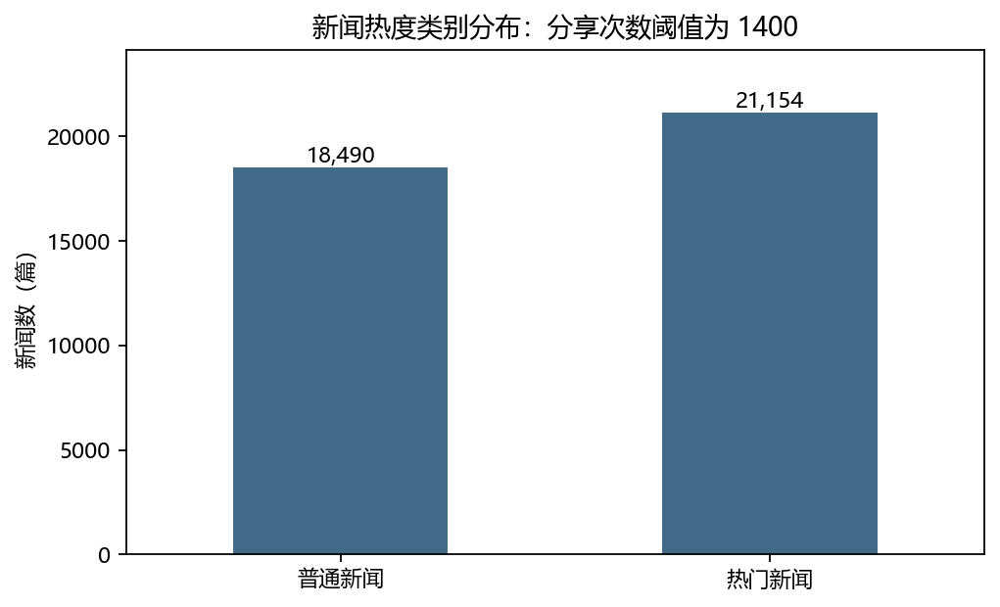
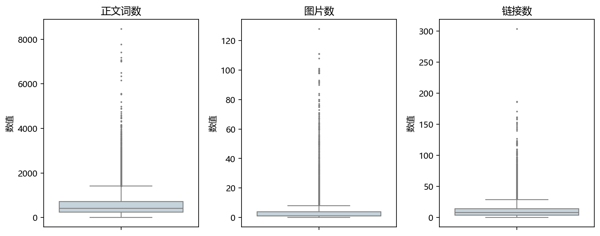
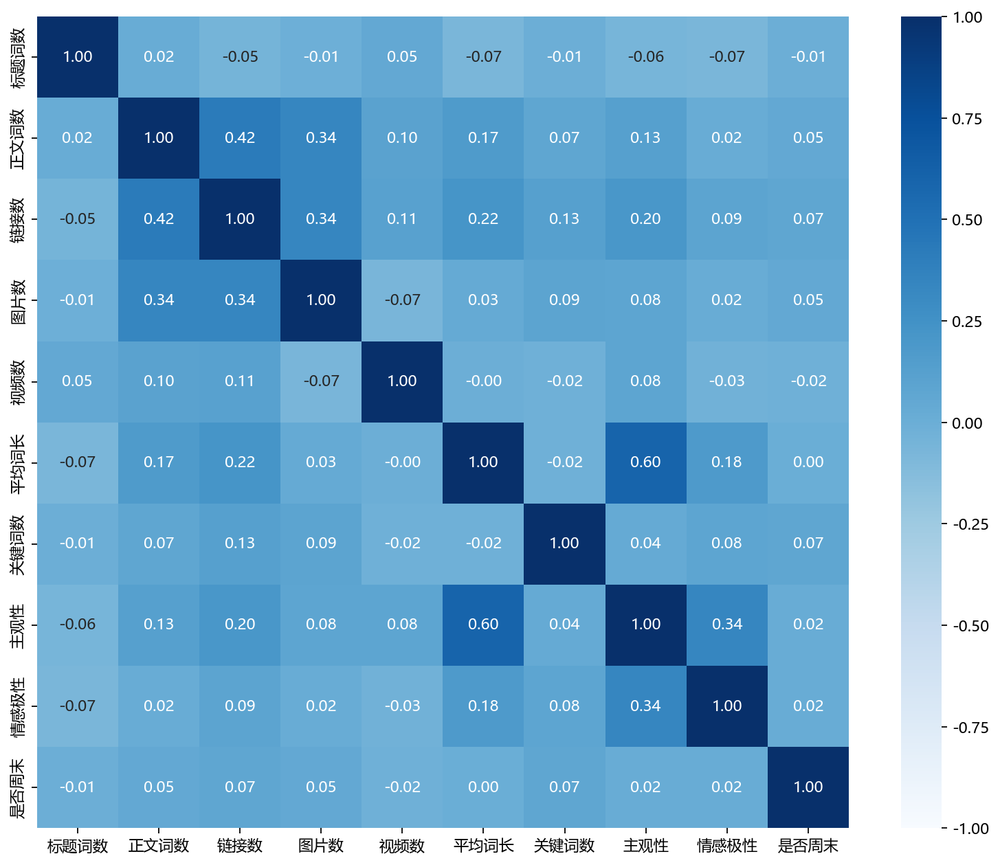
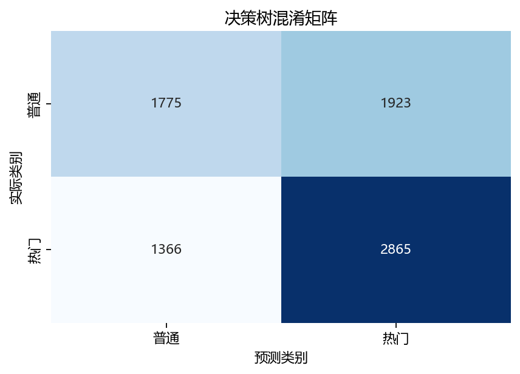
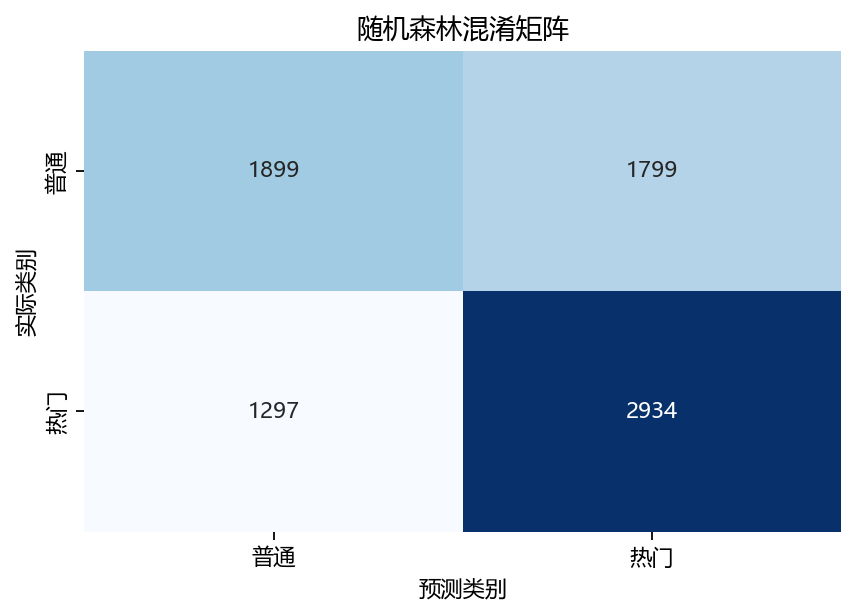
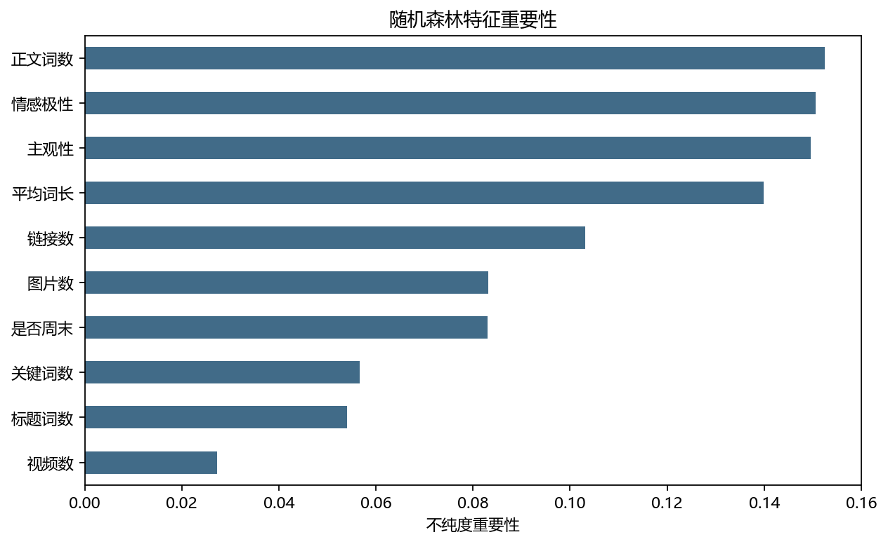
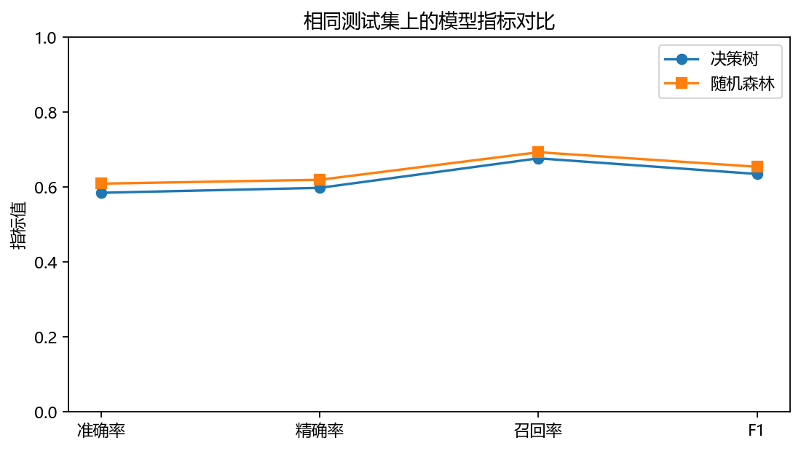

### 01_class_distribution

普通新闻 18,490 篇，热门新闻 21,154 篇。按固定阈值分组，分层抽样保留类别比例。

### 02_boxplots

箱体表示中间 50% 的观测，须外点为 IQR 规则识别的长尾。长正文、多图片和多链接不必然是错误，本实验保留这些样本。

### 03_correlation

单元格表示特征间 Pearson 相关系数，色阶固定为 −1 至 1。相关性描述线性关系，不代表对新闻热度的因果影响。

### 04_confusion_decision_tree

行是实际类别，列是预测类别。正确预测 4,640/7,929 篇；普通误判为热门 1,923 篇，热门漏判 1,366 篇。

### 04_confusion_random_forest

行是实际类别，列是预测类别。正确预测 4,833/7,929 篇；普通误判为热门 1,799 篇，热门漏判 1,297 篇。

### 05_feature_importance

按随机森林分裂不纯度下降量排序，正文词数 在本模型中的重要性最高。该指标可能偏好连续特征，不应解释为因果贡献。

### 06_model_comparison

横轴为不同评价指标，连线仅用于对照同一模型，不表示时间趋势。热门新闻为正类，F1 是精确率与召回率的调和平均。